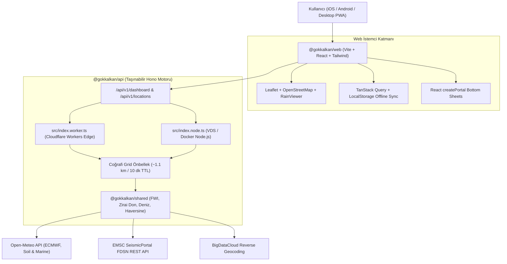

# 🛡️ GÖKKALKAN (Sky Shield)

> **Bölgesel Meteorolojik, Tarımsal, Denizcilik ve Çevresel Erken Uyarı Radarı**  
> *Regional Weather, Agricultural, Marine & Seismic Early Warning Radar PWA*

[](LICENSE)
[](https://www.typescriptlang.org/)
[](https://react.dev/)
[](https://vitejs.dev/)
[](https://tailwindcss.com/)
[](https://hono.dev/)
[](https://leafletjs.com/)

---

## 🌟 Genel Bakış

**GÖKKALKAN**, bölgesel hava tahminini salt sıcaklık göstermekten çıkarıp; **tarımsal zirai don riski**, **deniz dalga ve seyir uygunluğu**, **EMSC canlı sismik aktivite akışı**, **orman yangını tehlike indeksi (FWI)** ve **RainViewer canlı meteoroloji radarı** ile birleştiren yeni nesil bir İlerici Web Uygulamasıdır (PWA).

Uygulama; **Apple Human Interface Guidelines (HIG)** estetiği, **iOS Liquid Glass** yüzen gezinme kapsülü, **dairesel tema perdelemesi (`circle(...)`)** ve **%100 saf SVG vektörel ikon kütüphanesi** ile tasarlanmıştır.

---

## ✨ Öne Çıkan Özellikler

### 1. 🌦️ Canlı Gösterge Paneli ve 24 Saatlik Risk Şeridi
- **Dinamik GPS & Ters Coğrafi Kodlama:** Tarayıcı konumunu otomatik algılar; tüm Türkiye ilçe ve köylerini BigDataCloud API ile anında çözümler.
- **İnteraktif 24 Saatlik Scrubber:** Parmağınızı veya fareyi saatlik barlar üzerinde gezdirdikçe anlık sıcaklık ve 4 yarım yay kadranı reaktif olarak kayar.
- **4'lü SVG Yarım Yay Kadranları:** Yağış ihtimali, Rüzgar hamlesi, Dolu & Yıldırım fırtına riski, Orman Yangın Hava İndeksi (FWI).

### 2. 🗺️ Tam Ekran Gerçek Harita (OpenStreetMap & RainViewer)
- **Açık Kaynak & Sıfır API Key:** Leaflet motoru üzerinde resmi **OpenStreetMap** (Açık mod) ve Apple Midnight tarzı filtreli Gece modu altlığı.
- **Canlı Yağış Radarı:** RainViewer API döşemeleriyle son 2 saatlik yağış kütlelerinin hareketini oynatan zaman kontrolörü.
- **Sismik Fay & Deprem:** Kuzey Anadolu Fayı (KAF) ve Doğu Anadolu Fayı (DAF) vektörel hatları, EMSC gerçek zamanlı episantr şok dalgaları (`pulse-ring`) ve detay kartı.
- **Rüzgar & FWI Düğümleri:** Kritik boğazlarda (İstanbul, Çanakkale vb.) dönen rüzgar okları ve orman yangını tehlike rozetleri.
- **Tıklanabilir Konum Keşfi:** Haritada herhangi bir noktaya tıklandığında anlık koordinat verisi ve *"Bu Konumu Seç"* popover'ı.

### 3. 🌾 Tarlam (Zirai İzleme) & ⚓ Denizde (Seyir Analizi)
- **Zirai Don ve İlaçlama:** Toprak nemi (%0-100), yüzey toprak sıcaklığı, gece ayazı ve ilaçlama rüzgar uygunluğu analizi.
- **Denizcilik:** Dalga yüksekliği (m), dalga periyodu (s), rüzgar hamlesi (knot) ve seyir elverişlilik tavsiyeleri.

### 4. 🔔 Gökkalkan Erken Uyarı Nöbet Kuralları
- Don nöbeti (< 2°C), yakın sismik aktivite (M >= 3.0 ve < 150 km), deniz fırtınası (> 25 knot) ve yangın tehlikesi (FWI > 35) için iOS switch'li hassasiyet ayarları ve son 48 saatlik olay geçmişi.

### 5. 📅 7 Günlük Sıcaklık Erim Çubukları (Apple Weather Stili)
- Haftanın en düşük ve en yüksek sıcaklıklarına göre renkli gradyan aralık çubukları ve anlık sıcaklık gösterge noktası. Güne tıklandığında 8 saatlik detay çekmecesi (`createPortal` ile Stacking Context hapsinden muaf).

---

## 🏗️ Mimari ve Çift Çalışma Zamanı (Dual-Runtime)

GÖKKALKAN arka yüzü, **Hono** framework'ü ile tek bir kod tabanından hem **Cloudflare Workers (Edge)** hem de **VDS / Docker (Node.js)** üzerinde sıfır kod değişikliğiyle çalışacak şekilde taşınabilir mimaride yazılmıştır.



---

## 📁 Proje Dizin Yapısı

```
HavaDurumu/
├── packages/
│   ├── shared/            # TypeScript tipleri, FWI yangın formülü, zirai/deniz ve karar motoru
│   │   ├── src/           # riskEngine.ts, types.ts, index.ts
│   │   └── tests/         # 28/28 Vitest birim testi
│   ├── api/               # Taşınabilir Hono API servisi (Worker & Node.js çift giriş)
│   │   ├── src/           # services/, middleware/, app.ts, index.worker.ts, index.node.ts
│   │   ├── Dockerfile     # VDS ve Docker Compose hazır dağıtım paketi
│   │   ├── wrangler.toml  # Cloudflare Workers yapılandırması
│   │   └── tests/         # 9/9 Vitest API entegrasyon testi
│   └── web/               # Vite + React + Tailwind CSS PWA
│       ├── src/
│       │   ├── api/       # TanStack Query istemcisi ve çevrimdışı önbellekleme
│       │   ├── components/# Leaflet harita, dashboard, bento kartlar, yüzen navbar
│       │   ├── services/  # RainViewer API, uyarı kuralları, ayarlar deposu
│       │   └── views/     # Bugün, Harita, Uyarılar, 7 Gün, Ayarlar
│       └── vite.config.ts # PWA Manifest (standalone, theme_color)
├── prototype/             # Bağımsız çalışan etkileşimli HTML/CSS prototipi
├── CONTEXT.md             # Alan sözlüğü ve teknik mimari bağlamı
├── SPEC.md                # 4 zorunlu Mermaid şemalı teknik şartname
├── DESIGN.md              # Google Stitch / Apple HIG token ve stil sözleşmesi
└── ROADMAP.md             # 5 biletlik gelişim kararları ve tamamlanma durumu
```

---

## 🚀 Hızlı Başlangıç

### Gereksinimler
- Node.js 18.0 veya üzeri
- npm (workspaces desteğiyle)

### 1. Bağımlılıkları Kurun
```bash
git clone https://github.com/brhnshn/gokkalkan.git
cd gokkalkan
npm install
```

### 2. Testleri Çalıştırın
```bash
# Tüm monorepo testlerini (37/37 birim ve entegrasyon testi) doğrular
npm test
```

### 3. Geliştirici Sunucularını Başlatın

**Terminal 1 (Backend - Port 3001):**
```bash
cd packages/api
npm run dev:node
```

**Terminal 2 (Frontend PWA - Port 3000):**
```bash
cd packages/web
npm run dev
```

Tarayıcınızda `http://localhost:3000` adresini açarak uygulamayı test edebilirsiniz.

---

## 🌐 Canlı Dağıtım (Production Deployment)

### Cloudflare Workers (Ücretsiz Edge Katmanı)
```bash
cd packages/api
npx wrangler deploy
```

### VDS / Linux Sunucu (Docker Compose)
```bash
cd packages/api
docker compose up -d --build
```

### Frontend (Cloudflare Pages / Vercel / Netlify)
```bash
cd packages/web
npm run build
# 'dist' klasörünü dilediğiniz statik barındırma platformuna bağlayın.
```

---

## 🎨 Tasarım Prensipleri
- **Sıfır Emoji (%100 SVG):** Arayüzde hiçbir işletim sistemi emojisi kullanılmaz; tüm ikonlar Apple SF Symbols kalitesinde ince çizgili özel SVG'dir.
- **Açık Tema Önceliği:** Varsayılan olarak ferah Alabaster & Slate tonları (`#f4f6fa`), alternatif olarak tek tıkla tıklanan noktadan yayılan dairesel tema perdelemesi (`circle(...)`) ile Deep Midnight gece modu.
- **Havada Yüzen Kapsül:** Ekran altına yapışmayan, alttan ve yanlardan yüzen cam hap navigasyon çubuğu (`rounded-full`, `backdrop-blur-28px`).
- **Dokunsal Tepki (Tactile Bounce):** Yalnızca tıklanabilir butonlarda `active:scale-[0.97]` fiziksel yaylanma hissi; içerik kartlarında göz yoran hover sıçraması bulunmaz.

---

## 📄 Lisans

Bu proje [MIT Lisansı](LICENSE) kapsamında açık kaynak olarak lisanslanmıştır.  
Geliştirici: **Burhan Şahin** ([@brhnshn](https://github.com/brhnshn))
