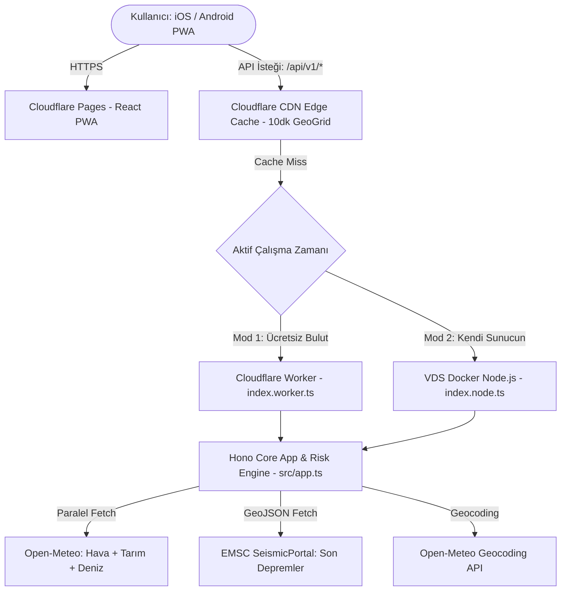
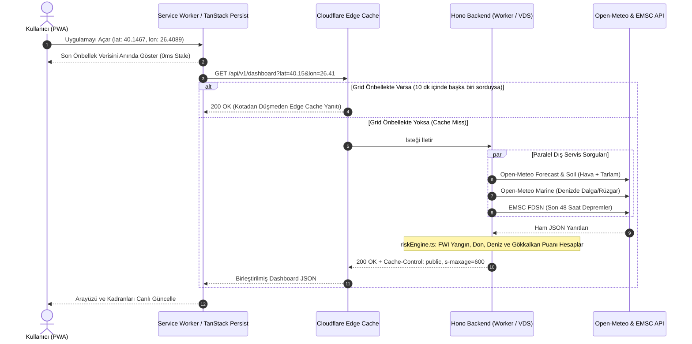
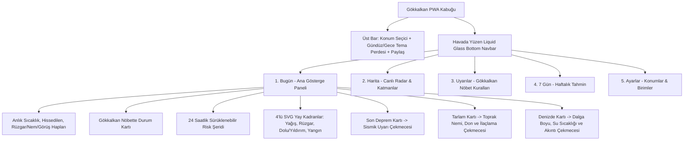
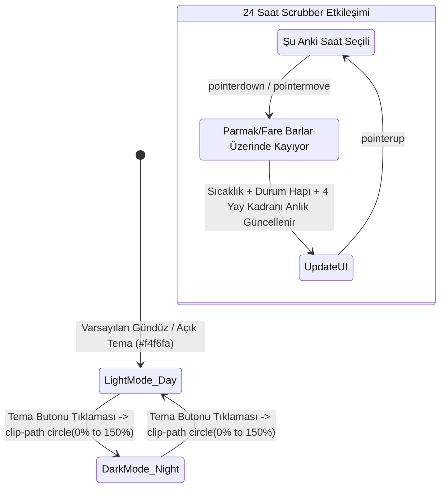

# GÖKKALKAN (HavaDurumu) — Teknik Şartname (`SPEC.md`)

Bu belge, **Gökkalkan PWA + Çift Ortamlı (Cloudflare Worker / VDS) Hono Backend** sisteminin mimari topolojisini, veri akışlarını, sayfa hiyerarşisini ve API sözleşmelerini tanımlar.

---

## 1. Sistem ve Çift Ortamlı (Dual-Runtime) Dağıtım Mimarisi

Backend katmanı **Hono + TypeScript** ile tek bir kod tabanında yazılır. İlk aşamada ücretsiz **Cloudflare Workers** üzerinde (100.000 istek/gün + CDN Edge Cache) çalışır; kota aşımı veya tercih durumunda **tek bir satır iş mantığı değiştirilmeden** doğrudan **VDS (Docker / Node.js)** üzerine alınabilir.



---

## 2. Coğrafi Grid Önbellekleme (Geo-Grid Cache) ve Veri Birleştirme Akışı

Cloudflare ücretsiz kotasını (100k/gün) korumak ve istemciye 0ms'ye yakın yanıt dönmek için koordinatlar 2 ondalık basamağa (`~1.1 km` çaplı grid) yuvarlanır:



---

## 3. Ekran & Sayfa Hiyerarşisi (Site Map & Çekmeceler)



---

## 4. Animasyon, Tema Perdelemesi ve Mikro Etkileşim Haritası



---

## 5. REST API Sözleşmeleri (Hono Backend)

### `GET /api/v1/dashboard?lat={number}&lon={number}&name={string}`
Tek bir istekte tüm ana ekranı, 24 saatlik şeridi, 7 günü, tarla/deniz analizini ve en yakın depremi döner.

```typescript
export interface DashboardResponse {
  location: {
    name: string;
    admin1?: string;
    lat: number;
    lon: number;
    isCoastal: boolean;
    updatedAt: string;
  };
  current: {
    temp: number;
    apparentTemp: number;
    high: number;
    low: number;
    conditionCode: number;
    conditionText: string;
    windSpeedKmh: number;
    humidityPct: number;
    visibilityKm: number;
    sunsetTime: string;
    sunriseTime: string;
  };
  sentinel: {
    level: 'SAFE' | 'CAUTION' | 'DANGER';
    badgeText: string;      // Örn: "GÖKKALKAN NÖBETTE"
    headline: string;       // Örn: "Bugün risk yok, keyfini çıkar"
    subline: string;        // Örn: "Sonraki 24 saat sakin · Gün batımı 18:27"
  };
  hourly24: Array<{
    timeIso: string;
    hourLabel: string;      // "Şimdi", "03:00", "06:00"...
    temp: number;
    conditionCode: number;
    conditionText: string;
    riskLevel: 'LOW' | 'MEDIUM' | 'HIGH';
    gauges: {
      precipitationPct: number;
      windKmh: number;
      hailLightningPct: number;
      fireRiskIndex: number; // 0 - 100 FWI normalize
    };
  }>;
  earthquake: {
    id: string;
    magnitude: number;
    region: string;
    distanceKm: number;
    hoursAgo: number;
    depthKm: number;
    source: 'EMSC';
    timeIso: string;
  } | null;
  agriculture: {
    status: 'DÜŞÜK RİSK' | 'ORTA RİSK' | 'YÜKSEK RİSK';
    frostRiskPct: number;
    soilMoisturePct: number;
    soilTempC: number;
    sprayingSuitable: boolean;
    recommendation: string;
  };
  marine: {
    isAvailable: boolean;
    status: 'UYGUN' | 'DİKKATLİ' | 'TEHLİKELİ';
    waveHeightM: number;
    wavePeriodS: number;
    windGustKnots: number;
    recommendation: string;
  };
  daily7: Array<{
    dateIso: string;
    dayName: string;
    conditionCode: number;
    conditionText: string;
    tempMin: number;
    tempMax: number;
    precipitationProbPct: number;
    windMaxKmh: number;
  }>;
}
```

### `GET /api/v1/locations/search?q={string}`
Open-Meteo Geocoding API üzerinden Türkiye ve dünya konumlarını arar, koordinat ve il/ilçe bilgisini döner.
